#### 👷 Check out what I'm currently working on

- [koooge/blog](https://github.com/koooge/blog) - Wannabe engineer&#39;s blog (today)
- [koooge/ubuntu-provisionings](https://github.com/koooge/ubuntu-provisionings) - Provisioning files for Ubuntu (1 day ago)
- [koooge/yomikazu](https://github.com/koooge/yomikazu) - Narrator ranking (1 week ago)
- [vectordotdev/helm-charts](https://github.com/vectordotdev/helm-charts) - Helm charts for Vector. (8 months ago)
- [koooge/dotfiles](https://github.com/koooge/dotfiles) - my dotfiles (10 months ago)

#### 🔨 My recent Pull Requests

- [fix: invert SlideShare icon inside a square background](https://github.com/koooge/hugo-theme-geppaku/pull/71) on [koooge/hugo-theme-geppaku](https://github.com/koooge/hugo-theme-geppaku) (today)
- [feat: add SlideShare author profile icon](https://github.com/koooge/hugo-theme-geppaku/pull/70) on [koooge/hugo-theme-geppaku](https://github.com/koooge/hugo-theme-geppaku) (today)
- [feat: configure author links and share buttons in display order](https://github.com/koooge/hugo-theme-geppaku/pull/69) on [koooge/hugo-theme-geppaku](https://github.com/koooge/hugo-theme-geppaku) (5 days ago)
- [fix: scope archive listings and preserve language in sidebar links](https://github.com/koooge/hugo-theme-geppaku/pull/68) on [koooge/hugo-theme-geppaku](https://github.com/koooge/hugo-theme-geppaku) (5 days ago)
- [chore: remove Pocket and Google&#43; share buttons](https://github.com/koooge/hugo-theme-geppaku/pull/67) on [koooge/hugo-theme-geppaku](https://github.com/koooge/hugo-theme-geppaku) (5 days ago)
